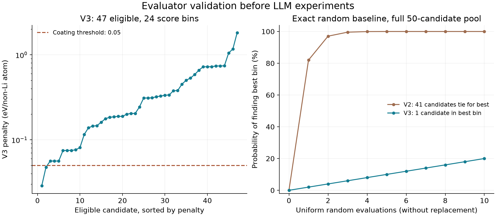

# Thermodynamic benchmark validation — 21 October 2026

**Outcome:** objective v3.0 is frozen after the user selected the
additional-contact-reaction criterion. The original absolute-decomposition objective
was unsuitable for the search experiment. No LLM performance claim has been tested.

## What was calculated

The existing 50-candidate pool was kept intact. Corrected GGA/GGA+U entries were
retrieved from Materials Project database **2026.09.28**, using mp-api **0.47.0**.
There are 4,887 entries across 949 queried chemical subsystems. Each contact's
complete subsystems were requested without a hull-distance filter on product phases.

The cathode is ordered LiCoO2, `mp-22526`; the electrolyte is ordered Li6PS5Cl,
`mp-985592`. These are the lowest-summary-hull ordered structures returned for the
configured formulas. Their alphabetical aliases are recorded in the artifacts.
All calculations use 4 V versus Li/Li+. These are static DFT thermodynamic proxies.

The pool's alphabetical MP IDs were resolved through the official emmet ID type,
not matched by formula. Retrieved candidate structures were checked against the
pinned pool structures with pymatgen StructureMatcher. Forty-nine candidates had
matching corrected entries. LiMgCl3 (`mp-aaahikjt`, alias `mp-3346453`) had no
GGA/GGA+U entry and remains a failed candidate; it was not silently replaced or dropped.
Two of the other candidates fail the 2 eV insulation gate, leaving 47 eligible.

The GGA/GGA+U scheme was selected because its corrected entries can be combined
across subsystems. Mixed r2SCAN correction values require system-specific treatment;
we do not combine them indiscriminately. See the
[MP phase-diagram documentation](https://docs.materialsproject.org/methodology/materials-methodology/thermodynamic-stability/phase-diagrams-pds).
The pool's summary hull prefilter and band gaps can originate from different property
calculations; their origins remain recorded. The 25 meV/atom prefilter is not a
claim of the same hull distance in this GGA/GGA+U benchmark.

## Why v2 was rejected

The original criterion took the maximum of coating self-decomposition and absolute
contact-reaction driving forces, including decomposition of the endpoints.
At 4 V, the electrolyte's self-decomposition penalty is **1.439628 eV/non-Li atom**;
the cathode's is **0.096678 eV/non-Li atom**.

The electrolyte imposes a common score floor on 41 candidates. All 41 tie in the
best eligible bin, and none meets the absolute acceptability threshold. Uniform
random search without replacement finds this best bin with probability 82% after
one evaluation and 99.5714% after three. This is unsuitable for distinguishing
selection strategies. We preserved the complete result in
`data/benchmarks/coating_v2_diagnostic.json`.

## Frozen v3.0 definition

The user explicitly selected this alternative before any strategy experiments:
measure **additional reaction on mixing separately equilibrated endpoints**, while
retaining coating self-stability and insulation checks.

For each phase, project out Li at mu(Li) = elemental Li energy minus voltage.
Let h(c) be the equilibrium grand-potential hull energy per non-Li atom. The contact
reaction energy is the minimum over mixing fraction x of:

`h((1-x)c1 + x*c2) - [(1-x)h(c1) + x*h(c2)]`.

The coating self-decomposition penalty is its pinned grand-potential energy minus
h(c_coating). The final nonnegative penalty is the maximum of this self penalty and
the magnitudes of the two favourable additional-contact-reaction energies.

- Require a known band gap >= 2 eV to be eligible.
- Rank by ascending fixed penalty bin, width 0.020 eV/non-Li atom.
- Preserve ties within a bin; raw energy does not break them.
- Define criterion acceptance as penalty <= 0.050 eV/non-Li atom plus insulation.
- Retain failed/missing-entry candidates in the 50-candidate query population.
- Record absolute endpoint instability as a diagnostic, not a hidden zero.

The additional reaction is relative to equilibrium product assemblages, not a
prediction that the pristine endpoint remains unchanged. A coating passing this
criterion **does not make the whole stack stable at 4 V**. Li transport, kinetics,
finite-temperature effects and experimental synthesis are outside the objective.
Thresholds are operational choices, not calibrated uncertainty bounds. Choosing a
more discriminating question is not itself evidence that an LLM will perform better.

## Numerical results

| Quantity | Original v2 | Frozen v3.0 |
|---|---:|---:|
| Candidate population | 50 | 50 |
| Successfully evaluated | 49 | 49 |
| Eligible after insulation gate | 47 | 47 |
| Occupied eligible score bins | 6 | 24 |
| Candidates in best bin | 41 | 1 |
| Candidates passing that version's criterion | 0 | 2 |
| Random best-bin success after 3 evaluations | 99.5714% | 6% |

V3's best-bin candidate is LiNbF6, with penalty 0.028772 eV/non-Li atom.
LiCaAlF6 also meets the criterion, at 0.047719. These are outputs of a proxy
benchmark, not experimentally validated recommendations.



This report and the benchmark file contain unqueried results. Keep both out of
agent prompts; use the query interface in [EVALUATOR_HANDOFF.md](EVALUATOR_HANDOFF.md).

## Solver and software verification

The convex-hull minimum is solved as a linear program with non-Li element
conservation, nonnegative product amounts and a mixing fraction in [0,1]. This
avoids constructing every facet in a high-dimensional phase diagram. Pymatgen's
full hull solver is retained as an independent comparison.

Eight real-data comparisons cover LiF and LiNbF6, both endpoints and both reference
conventions. Maximum absolute LP/Qhull difference: **1.78e-15 eV/non-Li atom**.
See `data/benchmarks/solver_crosscheck.json`. Synthetic tests cover oxidation,
interior mixing reactions, metastable polymorphs, unit normalization and missing data.

The complete suite passes **82 tests**. A three-query random integration smoke run
completed through the frozen query API. Re-evaluating all candidates from the tracked
compressed dataset reproduced all 50 statuses and numerical outcomes exactly.
Per-candidate evaluator work totalled roughly 5–7 seconds on this machine, excluding
retrieval and dataset loading. This supports a sample-efficiency benchmark, not an
actual compute-saving claim for cheap-mode search.

A serialization problem with typed Element keys was fixed without changing corrected
energies. A hash round-trip issue involving integer histogram keys was also fixed;
canonical benchmark files supersede the earlier local draft files. Regression tests
cover both. No live LLM call and no new MLIP relaxation was performed.

## Frozen artifacts and reproducibility

- Pool: `data/pools/mp_candidates_v2.json` (original file retained; its snapshot is
  pinned by the frozen benchmark despite its historical draft-status label).
- Thermodynamic source: `data/thermo/mp_gga_v2.json.gz`, about 7.1 MB compressed.
  It includes structures, corrected energies, provenance and query metadata.
- Frozen benchmark: `data/benchmarks/coating_v3.json`.
- Planned PET-MAD subset: `data/benchmarks/mlip_followup_plan.json`; not executed.

Hashes:

- Pool: `e850b4f1d77e12e895d6d5446ab80f3210184842b6c91ecf88577158c34a8758`
- Thermodynamic data: `e9fa1add41e7a5a5b3f42522e59f1c8915c9ad6fd428d0289e80069918cb48e4`
- Objective v3.0: `a194076f6e3f671ed09e49baf3b65dccef436adcee4b9094d45577752cab6c0d`
- Frozen benchmark: `d2718c20f0ca8c3cc25d2378011bc68736ad71a502d657312bfff1da15a4ecfa`

Hashes cover canonical JSON content, excluding each artifact's own sha256 field;
the thermodynamic hash is of the uncompressed content, not gzip bytes.

```sh
# No API calls; use a fresh output filename each time.
MPLCONFIGDIR=/private/tmp/interphaise-mpl .venv/bin/python scripts/evaluate_pool.py \
  --contact-reference equilibrated --output runs/replay_new.json
MPLCONFIGDIR=/private/tmp/interphaise-mpl .venv/bin/python scripts/check_thermo_solver.py
MPLCONFIGDIR=/private/tmp/interphaise-mpl .venv/bin/python scripts/query_benchmark.py \
  --budget 3 --seed 0 --output runs/query_new.json
```

Re-evaluation produces a new diagnostic artifact, never overwrites the frozen
benchmark, and uses the same numerical v3 definition under a draft version label.
Raw provider retrieval can be resumed with `scripts/fetch_thermo_dataset.py`; a new
provider snapshot is not guaranteed to reproduce this pinned dataset.

## What remains

Adem can integrate the budgeted query interface into prior-only, no-feedback,
true-feedback and shuffled-feedback experiments. Freeze prompts, seeds, sampling
settings and budgets before the main repeats. Record Haiku 5.5 through direct
Anthropic only. Do not give the agent these exhaustive diagnostics.

Davide's PET-MAD follow-up plan selects the three highest-ranked distinct formulas
and a uniform random comparator with seed 2026. The comparator happens to be
LiCaAlF6, already in the shortlist; retain that overlap instead of cherry-picking a
worse comparator. Facet/termination protocol, convergence and per-candidate compute
accounting still need implementation/validation before reporting adhesion.
