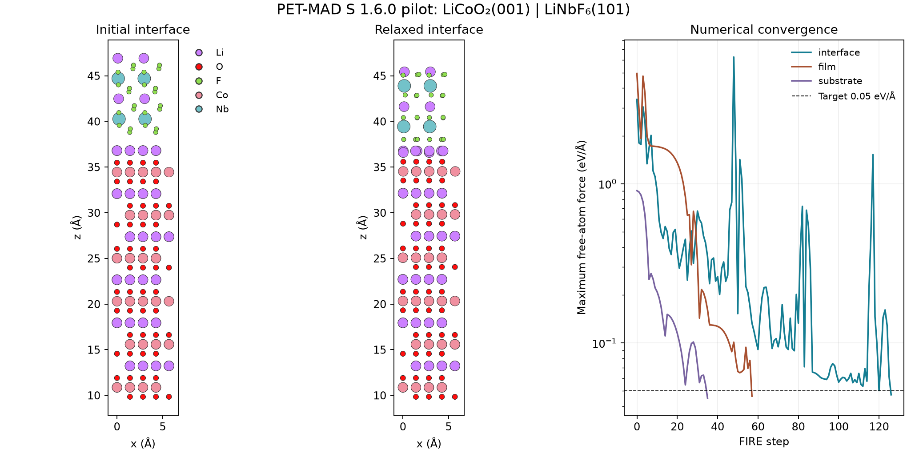

# PET-MAD interface pilot — 21 October 2026

**Completed:** pinned structures → lattice match → registry scan → three constrained
fixed-cell relaxations → adhesion estimate → structural inspection.

**Electrolyte side:** a second, feasibility-only pilot for Li6PS5Cl(111) | LiNbF6(101)
is described in [Electrolyte-contact feasibility pilot](#electrolyte-contact-feasibility-pilot).

For **LiCoO2(001) | LiNbF6(101)**, PET-MAD S 1.6.0 gives a provisional relaxed
work of adhesion of **2.1003 J/m²**. All movable atoms meet the 0.05 eV/Å force target
in the interface and both separated slab references. This is a single-contact,
polar-slab pilot, not a validated adhesion prediction or a two-contact coating score.

## Structure and protocol

LiNbF6 was selected because it occupies the best bin of the frozen v3 benchmark.
This choice did not depend on an MLIP result. Pinned structures came from the same
archived corrected MP dataset; their MP energies were not used in the adhesion sum.
The atomistic cells retain the MP-derived lattice constants, with coherent matching;
no separate PET-MAD bulk-cell optimization was performed.

- Cathode: `mp-22526` / `mp-aaaabhik`, conventional LiCoO2, (001).
- Coating: `mp-aaacjjwh`, conventional LiNbF6, (101).
- Terminations: `F2_C2/m_1` film and `Li_P6/mmm_1` substrate.
- Cell: **224 atoms** — 192 cathode atoms and 32 coating atoms.
- Contact area: **55.9942 Ų**; von Mises matching strain: **0.03071**.
- Layer-count parameters: 2 for each material. Actual initial z spans: 26.965 Å
  cathode, 8.113 Å coating; vacuum-over-film setting: 15 Å.
- Boundary conditions: periodic in all three directions, with vacuum separating
  images along z. One bonded interface per cell.
- Fix the bottom 34% of the substrate's z span: **64 fixed atoms**. Apply the same
  substrate constraints in the joined and separated calculations. Film atoms are free.
- Fixed cell throughout. FIRE, maximum 400 steps per relaxation, target 0.05 eV/Å.

We explored five symmetry-distinct low-index film facets against cathode (001),
with max area 160 Ų, ZSL length tolerance 5% and angle tolerance 3%. There were
38 enumerated candidates and four that passed the pilot's atom/strain/overlap/formal
charge gates. The initial 200-atom limit rejected all; it was increased to 256 before
MLIP evaluation. Selection minimizes atom count, then strain, then formal dipole
magnitude among ties. This is not an exhaustive facet or termination search.

The registry scan evaluated 2×2 in-plane offsets and gaps 2.0, 2.5 and 3.0 Å:
12 single-point calculations. The best sampled registry was offset (0,0), gap 2.0 Å.
Offsets in this small scan were energetically equivalent to float precision; a denser
registry search was not performed. Relaxation subsequently changes the contact geometry.

## Model and provenance

Model: **PET-MAD S 1.6.0, r²SCAN**, UPET conservative default, CPU, two Torch threads.
This neutral atomistic calculation has no explicit applied voltage, electron reservoir
or imposed grand-canonical Li exchange. It follows the electrochemical screen as a
separate mechanical/structural proxy; it does not simulate the v3 4 V ensemble.

The already-cached checkpoint was loaded directly because UPET's named-model loader
tries to list Hugging Face files even when weights are cached. Direct checkpoint
loading succeeded in offline mode. No new checkpoint download, API credential use
or live LLM call was needed.

Checkpoint SHA-256:
`3f52e97c459b2a28a94fc49b8a2f9a92551231a0ea4f5b5db2396f12d8ffa1e9`.
Hugging Face snapshot directory: `06774bd774562c6f801024f380c5af3026c66b60`.
Packages: UPET 0.3.1, Torch 2.14.1, ASE 3.29.0, pymatgen 2026.9.24,
pymatgen-core 2026.10.16.

## Energies, convergence and accounting

| Calculation | Final energy (eV) | FIRE steps | Max free force (eV/Å) | Calculator executions |
|---|---:|---:|---:|---:|
| Joined interface | −1557.216187 | 126 | 0.04723 | 128 |
| Separated coating | −206.647552 | 57 | 0.04628 | 59 |
| Separated cathode | −1343.228271 | 35 | 0.04506 | 37 |

The separated slabs start from the selected registry and relax independently in the
same cell and with the same stoichiometry and strain as their joined counterparts.

`W_adh = (E_film + E_substrate - E_interface) / area × 16.0217663`

This gives **2.100316 J/m²**; positive means the joined constrained system is lower
in energy than the two separately relaxed constrained slabs. No factor of two is
used: this vacuum geometry contains one bonded interface.

Total: **236 calculator executions**, comprising 12 registry calculations and 224
executions across three relaxations. These count ASE calculator executions, excluding
cached property reads; they are not a count of internal neural-network operations.
The counts reconcile exactly. Calculation wall time was **98.9 seconds**, of which
95.4 seconds were inside calculator execution; lattice enumeration is excluded.

Convergence is specifically of **movable atoms**. Unconstrained force maxima on fixed
atoms remain about **2.465 eV/Å** in both joined and separated cathode calculations.
This is a material limitation of the constrained reference geometry, not a force
convergence failure that should be hidden. A fully relaxed, constraint-insensitive
adhesion value has not been established.

## Structural inspection

Atom count, element order and cell remain unchanged. No overlap violation is found
in any of the three final structures under the existing covalent-radius gate.
The smallest cross-contact atom distance changes from 2.481 Å to 2.049 Å.
The interface's maximum atomic displacement is 1.624 Å; RMS displacement is 0.390 Å.
The coating z span contracts from 8.113 Å to 7.416 Å. The projected before/after
structure and force histories were rendered and visually inspected.



Both initial slabs have nonzero formal dipoles: |p_z|/A is about 0.158 e/Å for the
film and 2.021 e/Å for the substrate. Formal charges are neutral. Surface polarity,
large residual forces on fixed atoms and the finite-range MLIP limit interpretation.
Numerical convergence does not establish chemical accuracy, surface stability or
experimental adhesion. No reconstruction mechanism is inferred solely from this plot.

## Code and saved evidence

- `scripts/prepare_interface_pilot.py`: reproducible pinned-structure construction.
- `scripts/run_petmad_interface.py`: registry scan, relaxations, energies and accounting.
- `scripts/inspect_interface_pilot.py`: structural diagnostics and figure.
- `interphaise/tools/relaxation.py`: explicit convergence records and counted calculator.
- `interphaise/tools/matcher.py`: fix newer pymatgen's no-match exception to return the
  empty list promised by the wrapper contract.

Tracked evidence is in `data/petmad/linbf6_cathode_pilot_v1/`: construction attempts,
selected interface, initial/final structures, optimizer logs (as `fire.txt`), registry
energies, result and inspection. Detailed trajectories remain in ignored
`runs/petmad_interface_pilot/calculation_local/`.

**86 tests pass.** New tests cover cache-aware calculator counting, exhausted versus
converged relaxation, fixed-atom force reporting and the no-lattice-match case.

To reproduce with the local checkpoint, use a fresh output directory:

```sh
MPLCONFIGDIR=/private/tmp/interphaise-mpl .venv/bin/python scripts/prepare_interface_pilot.py
MPLCONFIGDIR=/private/tmp/interphaise-mpl HF_HUB_OFFLINE=1 .venv/bin/python \
  scripts/run_petmad_interface.py --output runs/petmad_repeat \
  --checkpoint /path/to/pet-mad-s-v1.6.0.ckpt
MPLCONFIGDIR=/private/tmp/interphaise-mpl .venv/bin/python \
  scripts/inspect_interface_pilot.py runs/petmad_repeat
```

Without `--checkpoint`, the pinned named-model loader may require network access.
Verify the checkpoint hash above when reproducing the exact run. Re-rendering the
archived inspection can use `data/petmad/linbf6_cathode_pilot_v1` directly and requires
no model download.

## Next decisions

The end-to-end path works and finishes quickly for this cell. Before comparative
adhesion ranking, validate a common protocol: PET-MAD bulk relaxation, less polar or
symmetric slab choices, constraint sensitivity, film thickness, vacuum and registry
sampling. Then calculate the coating–electrolyte contact and the same two-contact
protocol for the remaining shortlist. A single cathode contact cannot supply the
weakest-contact adhesion used in the planned full-mode ranking. Frozen v3 benchmark
results are unchanged by this pilot.

## Electrolyte-contact feasibility pilot

**Status:** construction and execution check, run before the protocol validation in
[EXPERIMENT_AMENDMENT.md](EXPERIMENT_AMENDMENT.md). Not a comparative adhesion value
and not a two-contact coating score together with the cathode pilot above.

**Matching finding.** With the cathode pilot's settings (max area 160 Ų, ZSL length
tolerance 5 %, angle 3 %, at most 256 atoms, strain gate 6 %), LiNbF6 has **no lattice
match** with Li6PS5Cl on any of its three substrate facets × five film facets. A 6 %
length tolerance gives only 6.2 % strain, which fails the gate. Raising only the area
cap to 300 Ų gives 8 valid of 38 enumerated interfaces. A shared two-contact protocol
therefore needs a cap of at least ~185 Ų.

**Selected structure.** The pilot rule (fewest atoms, then strain, then formal
polarity) selects Li6PS5Cl(111) | LiNbF6(101) with terminations `F2_C2/m_1` (film)
and `Li3Cl_R3m_4` (substrate). That is the same film facet and termination as the
cathode contact. 216 atoms: 104 Li6PS5Cl (36 fixed) and 112 LiNbF6. Area 183.022 Ų,
von Mises strain 0.01898. Formal |p_z|/A: film 0.170, substrate 0.130 e/Å. Pinned IDs:
film `mp-aaacjjwh`, substrate `mp-aaacebzk` (ordered F-43m approximant of a disordered
argyrodite; MP lattice, no PET-MAD bulk relaxation).

**Calculation.** Same runner and settings as the cathode pilot: 12-point registry
scan (best offset (0,0), gap 2.0 Å), FIRE to 0.05 eV/Å on free atoms, fixed cell,
PET-MAD S 1.6.0 on CPU with two threads, offline checkpoint with the hash above.

| Calculation | Final energy (eV) | FIRE steps | Max free force (eV/Å) | Max force incl. fixed (eV/Å) |
|---|---:|---:|---:|---:|
| Joined interface | −1190.939941 | 133 | 0.04613 | 0.805 |
| Separated LiNbF6 | −723.228577 | 70 | 0.04874 | (none fixed) |
| Separated Li6PS5Cl | −462.828217 | 103 | 0.04747 | 1.188 |

Provisional constrained **W_adh = 0.4275 J/m²**. 324 calculator executions (12
registry + 312 relaxation), reconciled; 120.6 s wall time. No overlap violations; max
displacement 1.725 Å, RMS 0.524 Å; minimum cross-contact distance 2.173 → 1.976 Å.
Li and Cl in the top argyrodite layers rearrange visibly; the film stays intact.
Fixed-atom forces are lower than on the cathode side but not negligible.

All the cathode pilot's limits apply. In addition, the two contacts used different
area caps and different substrate facet searches. Do not read 0.43 vs 2.10 J/m² as
"the electrolyte side is weaker" until both are rebuilt under one validated protocol.

Evidence: `data/petmad/linbf6_electrolyte_pilot_v1/` (same layout as the cathode
pilot; its inspection replays identically from the tracked files). Trajectories stay
in ignored `runs/petmad_electrolyte_pilot/`. Reproduce:

```sh
MPLCONFIGDIR=/private/tmp/interphaise-mpl .venv/bin/python scripts/prepare_interface_pilot.py \
  --contact electrolyte --all-substrate-facets --max-area 300 --output runs/petmad_electrolyte_repeat
MPLCONFIGDIR=/private/tmp/interphaise-mpl HF_HUB_OFFLINE=1 .venv/bin/python scripts/run_petmad_interface.py \
  --input runs/petmad_electrolyte_repeat --output runs/petmad_electrolyte_repeat/calculation \
  --checkpoint /path/to/pet-mad-s-v1.6.0.ckpt
MPLCONFIGDIR=/private/tmp/interphaise-mpl .venv/bin/python scripts/inspect_interface_pilot.py \
  runs/petmad_electrolyte_repeat/calculation
```
