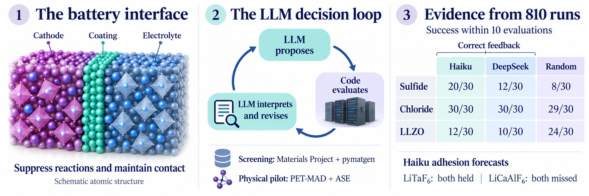
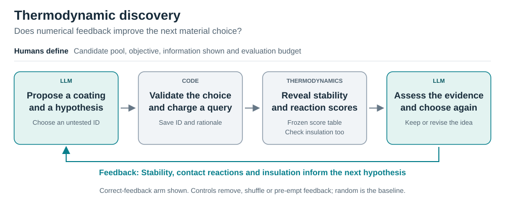
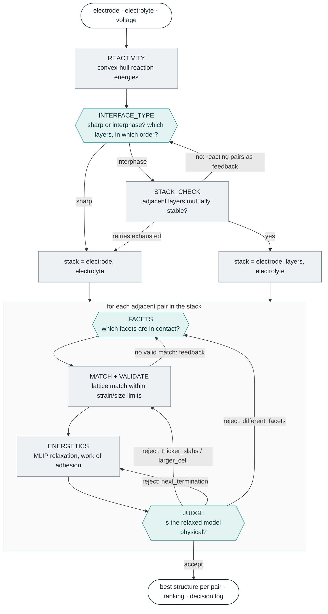

# interphAIse


interphAIse tests whether an LLM can choose the next useful calculation in the
search for protective solid-state battery coatings. The model proposes materials,
interprets feedback and forecasts properties. Materials Project thermodynamics
and PET-MAD atomistic calculations supply the numerical evidence.

Built for the OSI Hackathon 2026. The completed study compares Haiku 5.5 and
DeepSeek V3.2 across three battery environments and includes a prospective
three-coating physical pilot. Humans define the objectives and construction
rules; the LLM's scientific selection judgment is what we test.

**For reviewers:** [One-page report](docs/SUBMISSION_WRITEUP.md) ·
[Illustrated Word report](presentations/results_2026-10-22/interphaise_submission_illustrated_2026-10-22_v3.docx) ·
[Interactive interfaces](https://davidetisi.github.io/interphAIse/) ·
[Full results](docs/RESULTS_SYNTHESIS_2026-10-22.md)



*Conceptual illustration; atoms are schematic. Screening success does not
establish improved battery performance. The full policy comparison appears below.*

## Why the LLM is central

The scientific question is **what is worth calculating next, and why**. We
ask the LLM to take on specific parts of a researcher's scientific judgment:

- **Propose a chemical hypothesis:** connect knowledge of material families to
  a promising coating in the candidate pool.
- **Respond to evidence:** interpret previous results and decide whether to
  pursue the same idea or change direction.
- **Allocate limited evaluations:** choose which untested material deserves
  the next query.
- **Make testable predictions:** in the physical pilot, forecast adhesion at
  both contacts before the new calculations reveal the answer.

The LLM is the **scientific decision policy being tested**. Python code handles
orchestration, ID validation, budget accounting and evidence logging. Materials
Project thermodynamics and PET-MAD supply the numerical results. Humans define
the candidate space, objective and construction rules, and assess the scientific
meaning of the outcome.

The controls distinguish useful starting knowledge from useful adaptation to
feedback. The results show that their value depends on the model and battery
environment; the physical pilot also exposes failed predictions. This tests
delegated scientific judgment. It does not establish equivalence to human
intuition or reveal the model's internal reasoning mechanism; no matched human
expert comparison was run. See the [full interpretation](docs/RESULTS_SYNTHESIS_2026-10-22.md#why-the-llm-is-central).

## How it works

The diagrams show the scientific roles in two complementary studies. The model
configurations used in the completed experiments are listed separately below.
Teal boxes represent LLM judgments; grey boxes represent code and numerical tools.



The benchmark reveals precomputed scores for the queried candidate. Upfront
selects its whole shortlist before seeing results; sequential receives no
numerical outcomes; shuffled receives misassigned outcomes. Random search is
the baseline. The diagram shows the correct-feedback arm.


The physical pilot makes new calculations for selected coatings. Its forecasts
are saved before new energies exist, and sensitivity results are released only
after the final summary. The loop depicts the intended opportunity to revise:
the archived pilot's coating order stayed unchanged and some forecasts failed.

| Completed evidence | LLM configurations actually run |
|---|---|
| Thermodynamic discovery benchmark | Separate Haiku 5.5 and DeepSeek V3.2 runs |
| Prospective PET-MAD decision pilot | Haiku 5.5 in the [archived pilot](data/experiments/llm_petmad_pilot_v1/EXECUTION_summary.json) |

The project therefore uses both models; the physical pilot's recorded results
come from Haiku. The role labels in the diagrams are simply **LLM**, keeping the
workflow separate from the provenance of each experiment. These studies test
useful selection and prediction, not equivalence to a scientist's full judgment.

The SVGs are generated by [a small source script](scripts/build_workflow_diagrams.py).
Editable Mermaid versions are available for
[discovery](assets/diagrams/discovery-workflow.mmd) and
[interface tests](assets/diagrams/petmad-workflow.mmd).

<details>
<summary>Original modelling-screen architecture</summary>

The earlier design also lets a decision policy choose sharp contacts or reaction
layers, facets and responses to structural validation. This is the historical
screen architecture, not the protocol used for the completed discovery results.
See [the original modelling screen](docs/LEGACY_SCREEN.md) for its detailed steps.



</details>

## Reproduce the results

Use Python 3.12 and a full Git clone. From the repository root:

```bash
python3.12 -m venv .venv
source .venv/bin/activate
python -m pip install -e '.[dev,analysis,mp]'
python -m pytest -q
python scripts/reproduce_results.py
```

After installation, this workflow is offline: no API credential, model download
or GPU is needed. It rebuilds the analyses and viewer, replays 9,600 archived
queries and checks the frozen evidence. The clean-install suite passes 246 tests.
Open `runs/reproduced_results/structure_viewer.html` for the complete catalogue.
Generated files go into `runs/`, which is created automatically and ignored by Git.
See [REPRODUCE.md](REPRODUCE.md) for dependencies and individual analysis commands.

## What we found

The environment study contains **810 distinct runs**: 720 LLM runs and 90 shared
random runs, with 30 repeats per policy/environment and ten queries per run.

- **Sulfide:** Haiku with correct feedback succeeds in 20/30 runs, versus 2/30
  without result feedback and 6/30 with shuffled feedback. Both paired comparisons
  survive Holm correction. DeepSeek shows the same direction without corrected
  significance.
- **Chloride:** all LLM policies succeed in 30/30 runs; the shared random baseline
  succeeds in 29/30. This was a predeclared near-ceiling condition.
- **LLZO:** DeepSeek's upfront shortlists succeed in 20/30 runs versus Haiku's
  1/30. Both iterative policies remain below random (10/30 and 12/30 versus 24/30).
  Useful starting knowledge and useful adaptation are distinct capabilities.


Cross-model comparisons are descriptive, not matched reasoning compute. The
[full synthesis](docs/RESULTS_SYNTHESIS_2026-10-22.md) includes corrected tests,
controls, the earlier 150-run benchmark and the LLZO chemistry caveat.

In the prospective **Haiku/PET-MAD pilot**, both LiTaF6 adhesion forecasts held
and both LiCaAlF6 forecasts missed. The selection order did not change, so the
pilot demonstrates testable predictions rather than an adaptive-search advantage.

| Selected primary work of adhesion, J/m² | Cathode contact | Electrolyte contact |
|---|---:|---:|
| LiNbF6 | 3.617 | 1.633 |
| LiTaF6 | 3.339 | 1.577 |
| LiCaAlF6 | 1.427 | 0.744 |

These are provisional results for formally polar model interfaces. The small
Nb–Ta difference is below known construction sensitivities; LiCaAlF6 electrolyte
thickness and bulk-structure sensitivity remain unquantified. **LiF has no
computed interface energy.** Lithium transport, cycling and experimental coating
performance are not established. Decision-time evidence and later robustness
checks are archived separately.

## Explore the structures and evidence

[Open the public six-interface explorer](https://davidetisi.github.io/interphAIse/)
or [download the offline viewer](https://davidetisi.github.io/interphAIse/interphaise-referee-viewer.zip).
For the full local catalogue of 460 saved geometries and 141 candidate IDs:

```bash
python scripts/build_structure_viewer.py
```

Open `runs/structure_viewer.html`. The [viewer guide](docs/STRUCTURE_VIEWER.md)
explains comparison controls, provenance and downloads. The
[final physical comparison](data/petmad/coating_comparison_v1/FINAL_COMPARISON.md)
and [model comparison](data/experiments/deepseek_v1/model_comparison.md) link the
figures to their source evidence.

## Repository layout

| Folder | Contents |
|---|---|
| `interphaise/` | Scientific workflow, LLM policies and calculation tools |
| `scripts/` | Experiment runners, offline analyses and viewer exporters |
| `tests/` | Offline tests |
| `data/` | Frozen benchmarks, prompts, responses, structures and simulation evidence |
| `docs/` | Reports, protocols, guides and development history |
| `presentations/` | Slides, Word reports, source builders and validation records |
| `figures/` | Result plots and diagrams |
| `assets/` | Project branding |
| `benchmark/` | Literature cases for the earlier modelling screen |

The [documentation index](docs/README.md) separates current results from earlier
plans. See the [development log](docs/DEVELOPMENT_LOG.md) for the work history,
[release verification](docs/FINAL_INTEGRATION.md) for integration checks, and
[submission package](docs/SUBMISSION_PACKAGE.md) for the hackathon materials.
The [presentation guide](presentations/README.md) identifies which decks are
historical checkpoints.

New API or MLIP experiments are separate from offline reproduction. Follow
[the relevant protocols](docs/README.md) and [credential instructions](AGENTS.md).
The [earlier modelling screen](docs/LEGACY_SCREEN.md), including its orchestration
diagram and optional commands, is preserved as historical design.
