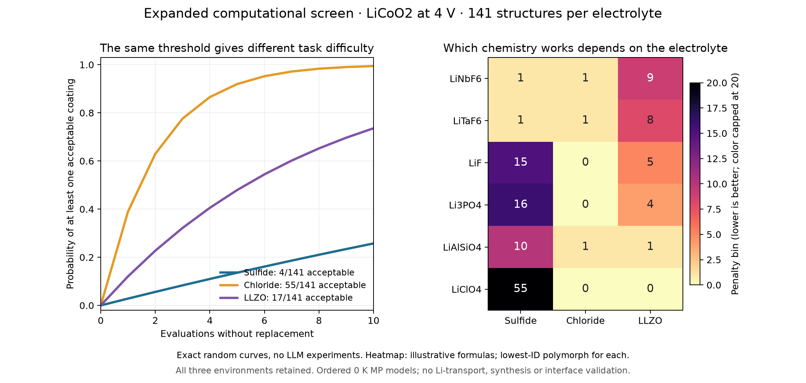

# Environment expansion: execution record

21 October 2026, branch `davide`. This work implements the previously prepared
exploratory expansion: 141 pinned coating structures across Li6PS5Cl, Li3InCl6
and Li7La3Zr2O12 (LLZO), with the same LiCoO2 endpoint, 4 V and v3 objective.
It does not freeze a new LLM experiment or modify the original benchmark.

## Endpoint decision, before scoring

Retain every endpoint selected in `environment_expansion_v1/plan.json`. The new
structures are suitable **ordered 0 K computational reference models** for this
screen, not validated descriptions of experimental conducting phases. Their
chemistry, full site occupancy and geometry were inspected before new scores:

| Endpoint | Pinned numeric ID | Space group | Primitive sites | Shortest atom distance |
|---|---|---|---:|---:|
| LiCoO2 | mp-22526 | R-3m | 4 | 1.917 Å |
| Li6PS5Cl | mp-985592 | F-43m | 13 | 2.057 Å |
| Li3InCl6 | mp-676109 | C2 | 60 | 2.505 Å |
| Li7La3Zr2O12 | mp-942733 | I4_1/acd | 96 | 1.895 Å |

Every saved structure is ordered and stoichiometric, with no coincident sites.
MP structure/energy task provenance is retained in the plan. The LLZO endpoint is
tetragonal and ordered, not doped/disordered cubic LLZO. Exact corrected-entry
structure matching still precedes scoring. PET-MAD-relaxed structures and energies
are excluded from these Materials Project phase diagrams.

## Retrieval and exhaustive evaluation completed

Added `scripts/fetch_environment_dataset.py`: query the complete subsystem union,
reuse corrected GGA/GGA+U data only at the same database version, resume hashed
cached batches, reject duplicate-entry conflicts and require complete query coverage.
If the live MP database version differs, retrieve a separate complete dataset.
Raw caches stay under ignored `runs/environment_expansion_v2/fetch/`; the sanitized
compressed dataset will be saved under `data/exploration/environment_expansion_v2/`.
No paid LLM calls, MLIP calculations or cluster jobs are part of this work.

The live database remains **2026.09.28**, so all original entries could be reused.
The complete expansion has **7,420 entries covering 2,379 required subsystem
queries**. There were 36 new batched `get_entries` calls for 1,430 missing systems.
The cached replay needed no further entry calls. During validation, inspection of
the installed MP client showed that its deprecated version getter only reads a
cached attribute; the fetcher now performs a fresh, credential-free heartbeat
request at completion. The replay independently confirmed the same version.

The final outputs are in `data/exploration/environment_expansion_v2/`. Every
planned combination is retained: **414 successful calculations and 9 explicit
missing-entry failures** (the same three missing coating IDs in each environment).
There are 120 eligible coatings in each environment: 138 computed, of which 18
fail the unchanged band-gap gate. Polymorphs remain separate candidates.

## Main measured result

**The environment changes which coating chemistry is preferred.** Every acceptable
sulfide coating contains fluorine; none of the 17 acceptable LLZO coatings does.
The unchanged fluoride-first rule therefore works for sulfide/chloride and fails
within the ten-query budget for LLZO. This is an exhaustive computational result,
not yet evidence that an LLM adapts correctly across environments.

| Electrolyte | Acceptable / 141 | Distinct acceptable formulas | Best bin (number tied) | Exact random acceptance by 10 | Exact random best bin by 10 | Fluoride-first: first acceptable / first best bin |
|---|---:|---:|---|---:|---:|---|
| Li6PS5Cl | 4 | 3 | 1 (3) | 25.74% | 19.94% | 3 / 13 |
| Li3InCl6 | 55 | 35 | 0 (38) | 99.43% | 96.18% | 1 / 1 |
| LLZO | 17 | 10 | 0 (1) | 73.57% | 7.09% | 40 / 76 |

There are 20 fluorine-containing candidates in the expanded pool. The sulfide
acceptable structures are LiCaAlF6, LiNbF6 and two LiTaF6 polymorphs. LiNbF6 and
both LiTaF6 structures tie in the best bin. The unique LLZO best-bin candidate is
LiClO4 (`mp-aaaabsvl`, penalty 0.0127888 eV/non-Li atom). That identifies a model
optimum only; it does not establish Li transport, synthesis compatibility or a
physically validated coating. All 38 chloride best-bin structures remain tied;
we do not secretly break that tie by their raw energies.

The missing pinned GGA/GGA+U entries are Li6Ti2O7 (`mp-aaagbgdu`, numeric alias
mp-2763586), Li6MgCl8 (`mp-aaahikjp`, mp-3346449) and LiMgCl3 (`mp-aaahikjt`,
mp-3346453). They remain explicit failed queries, with no formula-based replacement.
All required competing-phase systems were queried before any score was calculated.

### Why the scores change

Among 120 eligible candidates, the electrolyte contact alone controls the maximum
penalty for **110 sulfide, 25 chloride and 65 LLZO** candidates. Coating
self-instability alone controls 3, 68 and 52, respectively. The cathode contact
alone controls 7, 19 and 3. Eight chloride candidates have all three components
tied at numerical zero; the machine-readable diagnostics count these ties explicitly.

Binned-rank Spearman correlations are 0.679 (sulfide/chloride), 0.335
(sulfide/LLZO) and 0.592 (chloride/LLZO). Of the 120 shared eligible candidates,
109, 114 and 60 change bins in those comparisons. This rules out the concern that
the expansion simply repeats one invariant self-stability ranking.

Illustrative lowest-ID polymorphs show the chemistry switch:

| Coating | Sulfide bin | Chloride bin | LLZO bin |
|---|---:|---:|---:|
| LiNbF6 | 1 | 1 | 9 |
| LiTaF6 | 1 | 1 | 8 |
| LiF | 15 | 0 | 5 |
| Li3PO4 | 16 | 0 | 4 |
| LiAlSiO4 | 10 | 1 | 1 |
| LiClO4 | 55 | 0 | 0 |

These examples were selected after inspection for explanation, not as an
independent test set or a new material-selection rule.



## Scientific interpretation and next decision

The unchanged acceptance criterion is already very easy for the chloride model:
random search succeeds by ten evaluations 99.43% of the time, and even best-bin
success is 96.18%. Thus a large acceptance gain over random cannot be expected
there. Retain this environment as declared; report early-query curves and
best-bin regret rather than adjusting the threshold or discarding an inconvenient
task. LLZO acceptance is also relatively easy, while its unique optimum remains
harder to locate. The sulfide extension preserves every original candidate and
both original winners; it is not independent replication.

The LLM's prospective job is to replace the scientist who decides **which chemical
assumption to revise after a contact calculation fails**. For example, transferring
a fluoride preference from sulfide to LLZO is unsuccessful under this evaluator;
the model should use its observations to reconsider the next chemical family.
An upfront model may already know the environment distinction, so matched
no-feedback and shuffled controls remain necessary. The present work establishes
a useful test landscape, not the model's performance on it.

Before paid runs, jointly freeze a separate experiment with every endpoint and
pool unchanged, public prompts, common budgets/seeds, per-environment acceptance
and bin-regret curves, treatment of failed queries, and any aggregate statistic.
Keep every environment and label this study exploratory and informed by v3.
Do not combine its runs with the original 30-repeat cohort. The existing frozen
benchmark and its reported LLM results have not been changed.

The v3 criterion measures extra contact reaction relative to separately
equilibrated endpoints. At 4 V, endpoint self-decomposition penalties are
0.09668 for LiCoO2, 1.43963 for Li6PS5Cl, 0 for Li3InCl6 and 0.33584 for LLZO,
all eV/non-Li atom. An acceptable coating therefore does **not** imply that the
entire pristine stack is thermodynamically stable. The scoring omits transport,
finite-temperature disorder, kinetics, synthesis and physically converged adhesion.
All phase diagrams use corrected MP GGA/GGA+U only. Claude's PET-MAD work remains
a separate interface-validation workflow.

## Verification and accounting

- **Original-v3 replay:** all 50 rows reproduce, including the original missing
  entry; maximum numerical difference is **0.0** for penalties, contact energies,
  endpoint decomposition penalties, Li chemical potential and band gaps. IDs,
  selected corrected entries, status, insulation, bins and acceptability agree.
  Dataset hashes, timing and unused phase counts necessarily differ. Degenerate
  product assemblages/mixing fractions are not used as equality requirements.
- **Independent solver audit:** six predetermined LiF contact calculations
  (two contacts in all three environments) were recomputed by explicit Qhull
  grand-potential diagrams. Contact and self-decomposition values agree with
  linear programming to at most **8.88e-16 eV/non-Li atom**.
- **40 targeted tests pass.** The focused tests cover missing competitors, incompatible database versions,
  conflicting duplicate entries, exact random enumeration, ties and empty/sparse
  eligible-set behavior, existing pool selection and the unchanged evaluator.
- Verified all saved semantic hashes, source-code hashes, complete candidate-ID
  sets, 423-row accounting and unchanged original benchmark. A scan of the new
  scripts, tests, report and decompressed data found no configured credential
  values; `.env` remains ignored and untracked. Whitespace checks pass.
- The first exhaustive pass took 69.17 s; the final pass took **66.87 s** locally.
  The repeat used identical entries and scores after correcting the fetcher's
  final database-version check and confirming the fresh heartbeat. The first pass
  is preserved under ignored `runs/environment_expansion_v2/first_pass/`.
- Initial retrieval took 31.69 s and the cache replay 3.20 s. **36 batched MP
  `get_entries` calls total**; HTTP request/pagination counts were not instrumented.
  Credentials remained local and ignored. **No LLM, MLIP or cluster calls.**
- This work makes no commit, push, branch switch, collaborator-code modification
  or automatic benchmark freeze.

## Outputs, provenance and reproduction

New scripts are `scripts/fetch_environment_dataset.py`,
`scripts/evaluate_environment_expansion.py` and
`scripts/plot_environment_expansion.py`; new tests are
`tests/test_environment_evaluation.py`. The existing preparation script, original
v1 plan/pool and scientific evaluator are reused unchanged during this execution.

`data/exploration/environment_expansion_v2/` contains:

- `dataset.json.gz`: 7,420 corrected entries, completed query batches, input
  hashes, unchanged MP database version and final fresh-heartbeat verification.
- `fetch_accounting.json`: initial retrieval and cached replay accounting;
  exact entry/batch content equality checked across the two snapshots.
- `evaluation/endpoint_review.json`: structural checks, task identity and exact
  corrected-entry structure matching before scoring.
- `evaluation/lco_*.json`: all 423 results, complete exact-random curves,
  unchanged fluoride-first trajectories, optimum bins, per-row bin regret and
  objective-component diagnostics.
- `evaluation/summary.json`: input/code hashes, original replay, Qhull audit,
  cross-environment pair comparisons and measured evaluation time.
- `landscape.png`: two-panel scientific figure generated from verified hashes.
- `artifact_manifest.json`: file byte hashes and final validation accounting.

Key SHA-256 identifiers:

```text
pool:      833d5a687d4413cab1ab7cdd9007b56b924e3b2d2802ae26170d9f6a7f82e71d
dataset:   fe7a0e815fd31d325095707b483f4a30be26e13f8c40e12eeef4d7f747d0a5ea
objective: a194076f6e3f671ed09e49baf3b65dccef436adcee4b9094d45577752cab6c0d
audit:     2fe5770d5687306ac4451dd36cde28348a9b8d1d894ab349b885f8e6ced1ee62
```

Offline reproduction (choose fresh output paths; no key is needed):

```bash
MPLCONFIGDIR=/private/tmp/interphaise-mpl .venv/bin/python scripts/evaluate_environment_expansion.py \
  --output runs/environment_expansion_replay
MPLCONFIGDIR=/private/tmp/interphaise-mpl .venv/bin/python scripts/plot_environment_expansion.py \
  --results runs/environment_expansion_replay --output runs/environment_expansion_replay.png
MPLCONFIGDIR=/private/tmp/interphaise-mpl .venv/bin/python -m pytest -q \
  tests/test_environment_evaluation.py tests/test_environment_expansion.py \
  tests/test_thermo_dataset.py tests/test_discovery_evaluator.py tests/test_candidate_pool.py
```

To resume/retrieve data using the ignored local MP key:

```bash
MPLCONFIGDIR=/private/tmp/interphaise-mpl .venv/bin/python scripts/fetch_environment_dataset.py \
  --cache runs/environment_expansion_v2/fetch --output runs/environment_dataset_replay.json.gz
```

An incompatible cached database version is rejected. A fresh cache at a new live
version causes complete re-retrieval rather than mixing vintages; it constitutes
a new snapshot, and old numerical scores are not guaranteed to reproduce.
Evaluation times and creation timestamps naturally change output hashes on replay;
the numerical result and scientific input hashes are the reproducibility targets.
