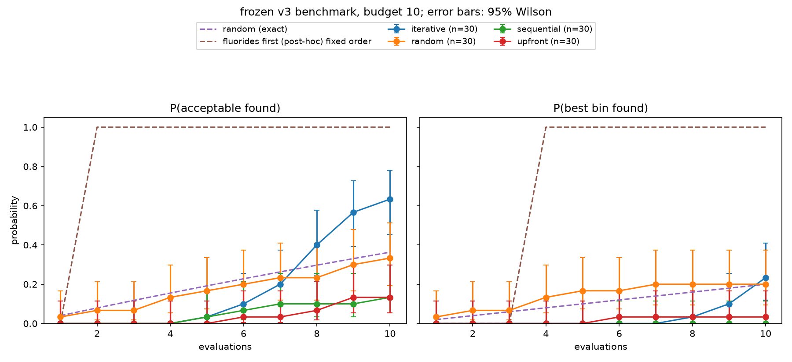

# Integrated discovery results — 21 October 2026

The merged workflow completed a new 30-repeat experiment per arm. Iterative Haiku
found a criterion-acceptable coating in **19/30 runs**, compared with **4/30** for
both upfront and sequential without feedback. This supports a benefit from supplying
queried outcomes in this fixed-pool task. It does not establish that an LLM is
necessary: the review-motivated fluoride-first heuristic succeeds at evaluation 2.

## What was merged and tested

Merged Adem's `work/agent-experiments` at `40e79c3` into `davide` in `c2171de`.
The production code is `6c81809`. Main was not modified. The independent local
preparation/inspection script edits were preserved outside these commits.

Before running, corrected invalid/repeated-ID accounting, versioned the prompt,
added independent clients/concurrency and portable provenance, and tightened
analysis validation. The full merged suite passed 92 tests; four added analysis
checks and one subsequent audit test also passed (97 tests across these runs).
A separate live smoke test completed three budget-3 LLM runs, seven calls, with
returned model `claude-haiku-5-5`. It is excluded from production statistics.

Production: frozen v3, 50 candidates, budget 10, seeds 100–129 with paired display
order, direct Anthropic `claude-haiku-5-5`, temperature 1.0, output cap 4096,
prompt `v3-2026-10-21c-charged-ids`, three independent runs in flight. See
[INTEGRATED_DISCOVERY_PROTOCOL.md](INTEGRATED_DISCOVERY_PROTOCOL.md), recorded
before production. This is a follow-up to Adem's earlier results, not a blind
original preregistration or a pooled extension of the old accounting protocol.

## Outcomes

| Strategy | Acceptable by query 10 | 95% Wilson interval | Best bin by query 10 |
|---|---:|---:|---:|
| Iterative, queried feedback | 19/30 (63.3%) | 45.5–78.1% | 7/30 (23.3%) |
| Upfront shortlist | 4/30 (13.3%) | 5.3–29.7% | 1/30 (3.3%) |
| Sequential, no results | 4/30 (13.3%) | 5.3–29.7% | 0/30 |
| Random sample | 10/30 (33.3%) | 19.2–51.2% | 6/30 (20.0%) |
| Exact uniform random | 36.33% | Exact finite-pool probability | 20.0% |
| Fluorides first, fixed order | Passes at query 2 | One deterministic order, no sampling interval | Best at query 4 |

The heuristic uses composition plus ascending candidate ID, and was chosen after
reviewing the exhaustive results. It is not a blind prior or an ensemble of 30 trials.



The iterative acceptance curve reaches 3/30 at query 6, 6/30 at query 7, 12/30 at
query 8, 17/30 at query 9 and 19/30 at query 10. Its advantage appears late in this
budget. The best-bin result is close to random (7/30 versus 6/30); do not generalize
an acceptance benefit into evidence of better optimum finding.

A supplementary paired analysis of iterative versus sequential gives 17 seeds
where only iterative succeeds, 2 where only sequential succeeds, 2 where both
succeed and 9 where neither succeeds: a +50 percentage-point observed difference.
The exact two-sided McNemar p-value is 0.000729. Iterative versus upfront gives
16 versus 1 discordant seeds (p=0.000275); versus sampled random, 13 versus 4
(p=0.0490). These supplementary comparisons are unadjusted; the random contrast
should not be elevated into a strong general claim. Pairing controls candidate
list order, not provider random sampling. The exact binomial method is described
in [statsmodels' McNemar documentation](https://www.statsmodels.org/stable/generated/statsmodels.stats.contingency_tables.mcnemar.html).

## Sensitivity and the role of the LLM

The original post-hoc threshold sensitivity remains relevant. Reaching bin <= 2
succeeds in 26/30 upfront, 22/30 iterative, 18/30 random and 13/30 sequential runs.
This is a secondary sensitivity calculation, not the frozen acceptance endpoint.
It again shows that upfront prior knowledge often reaches near-threshold coatings.
The 0.050 eV/non-Li-atom threshold cuts bin 2, so bin ties and acceptance need not
agree; do not equate a small threshold difference with proven materials accuracy.

The human activity being automated is choosing the next candidate after observing
why an earlier choice failed. The first iterative run (seed 100, selected by seed,
not by success) moves from Li3PO4 and LiF to other anion families, then revisits
chlorides because their queried penalties were lower. It also makes an ID typo,
gets a failed result, and corrects it at the cost of another query. This run fails
to find an acceptable coating. It illustrates both feedback-dependent choices and
limitations; it is not a success story selected for a slide.

The quantitative feedback contrast is stronger evidence than plausible prose, but
it does not prove chemically sound reasoning. Shuffled feedback has not been run.
The simple heuristic beats the LLMs here, and this inexpensive cached benchmark
cannot demonstrate real compute savings. Li transport, synthesis and physically
converged adhesion remain unvalidated.

## Completeness, costs and reproducibility

All 120 runs completed, with all 1,200 evaluations present. Every saved query result
was independently replayed through BenchmarkQueries and matched exactly. No run
was discarded or replaced. Failed candidate queries remain in the budget:

| Arm | Missing thermodynamic entry | Unknown ID | Repeated ID |
|---|---:|---:|---:|
| Iterative | 22 | 4 | 0 |
| Sequential | 2 | 2 | 1 |
| Upfront | 0 | 5 | 0 |
| Random | 1 | 0 | 0 |

Production made **631 proposal calls**, including one schema-repair attempt:
300 iterative, 301 sequential and 30 upfront. Recorded usage is **2,773,563 input
and 576,415 output tokens**, with usage present for every proposal attempt. This
excludes the seven-call pilot. Provider-internal charges for any HTTP retries are
not separately known, and no monetary estimate is inferred from call counts.

The complete sanitized archive is
[data/experiments/integrated_v3_20261021_s100](../data/experiments/integrated_v3_20261021_s100).
It includes 120 run JSON files with prompts, responses and metadata, experiment
manifest, checksums of source files, summary, query-replay audit and plot. Configured
credential values were checked and are absent. No credentials/HTTP headers were
copied. Frozen data and objective hashes match all run records.

```bash
MPLCONFIGDIR=/private/tmp/interphaise-mpl .venv/bin/python scripts/analyse_discovery_experiment.py \
  data/experiments/integrated_v3_20261021_s100 \
  --summary runs/reproduced_summary.json --plot runs/reproduced_curves.png
MPLCONFIGDIR=/private/tmp/interphaise-mpl .venv/bin/python scripts/audit_discovery_batch.py \
  data/experiments/integrated_v3_20261021_s100 --output runs/reproduced_audit.json
```

Next scientific work is a fixed shuffled-feedback control and validation of the
PET-MAD bulk/slab protocol. Neither is required to reproduce this completed batch;
both matter before stronger reasoning or materials-discovery claims.
