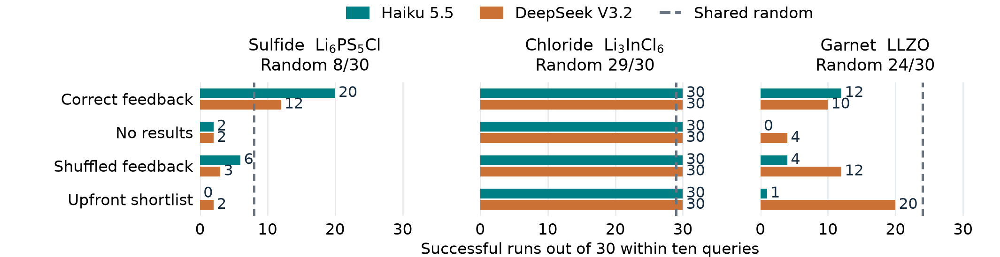

# interphAIse for battery coating discovery

We built interphAIse to test whether large language models can take over a scientist's choice of what to calculate next when searching for protective battery coatings. Controlled experiments and prospective atomistic forecasts show when numerical feedback helps, when chemical priors mislead, and why AI judgment needs physical verification.

Reactions between a cathode and a solid electrolyte can create resistive layers and degrade a battery. A coating should suppress these reactions, adhere to both solids and allow lithium transport ([Xiao et al., 2019](https://ceder.berkeley.edu/publications/Joule2019_coating.pdf)). Simulating it is difficult because surface termination, strain, atomic alignment and disorder change the interface; composition alone is insufficient.

We combined Materials Project structures, pymatgen thermodynamics and an auditable LLM decision loop. The model proposes candidates, interprets results and predicts properties; deterministic code runs calculations and enforces budgets. This delegates the hypothesis-selection part of human intuition. We froze 141 structures across sulfide, chloride and LLZO garnet electrolytes against LiCoO2 at 4 V, scoring coating self-stability, additional contact reactions and an electronic-insulation proxy. Cheap exhaustive tables provide ground truth for decision quality, rather than demonstrating compute savings.

We completed 810 runs: 720 with Haiku 5.5 or DeepSeek V3.2 and 90 shared random runs, with 30 per policy/environment and ten queries each. Four LLM policies distinguish upfront knowledge, sequential selection without results, correct feedback and shuffled feedback. Haiku's sulfide feedback arm succeeded in 20/30 runs versus 2/30 without results and 6/30 with shuffled results; both paired comparisons survived Holm correction. DeepSeek showed the same direction without corrected significance. Chloride was at ceiling. In LLZO, DeepSeek's upfront shortlist succeeded in 20/30 versus Haiku's 1/30, yet both iterative policies lost to random. Useful starting knowledge and useful adaptation are different capabilities.

*Success means finding at least one candidate passing the frozen proxy. Model comparisons are descriptive; reasoning compute was not matched.*

In a prospective Haiku pilot, [PET-MAD S 1.6.0](https://github.com/lab-cosmo/upet), trained on r²SCAN, supplied energies through ASE/UPET for six interfaces. With LiNbF6 as reference, Haiku chose LiTaF6 and LiCaAlF6 and forecast adhesion before their calculations. Both LiTaF6 forecasts held; both LiCaAlF6 forecasts missed. The electrolyte was correctly predicted as the weaker contact, with relaxed adhesion estimates of 1.63, 1.58 and 0.74 J/m², respectively. Choice order did not change, so this pilot demonstrates testable scientific predictions, not an adaptive-search advantage.

Our contribution links feedback controls to prospective physical tests and preserves the evidence available at each decision. Battery researchers could use it to delegate candidate triage and expose failed chemical analogies. The evidence does not establish human-level judgment or a superior coating: polar interfaces remain provisional, lithium transport and cycling are untested, and the thermodynamic proxy admits some practically questionable LLZO candidates. Transport, stronger chemistry baselines and higher-fidelity validation are next.

[Public code and evidence](https://github.com/DavideTisi/interphAIse), [offline reproduction](https://github.com/DavideTisi/interphAIse/blob/main/REPRODUCE.md) and the [six-interface explorer](https://davidetisi.github.io/interphAIse/) are available. The integrated suite passes 246 tests; all 9,600 archived benchmark queries replay.
